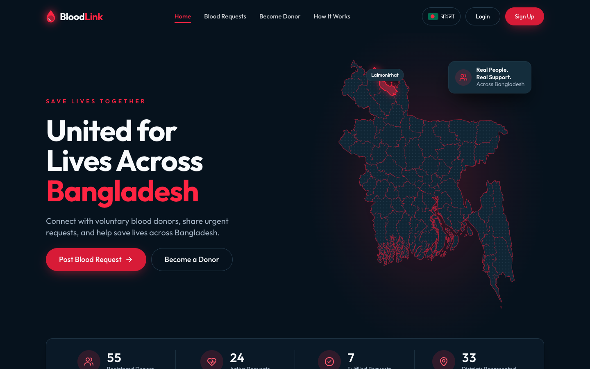
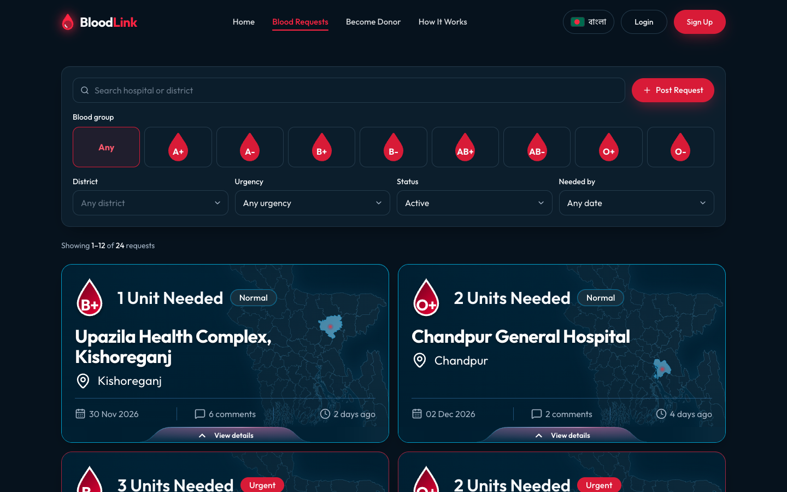
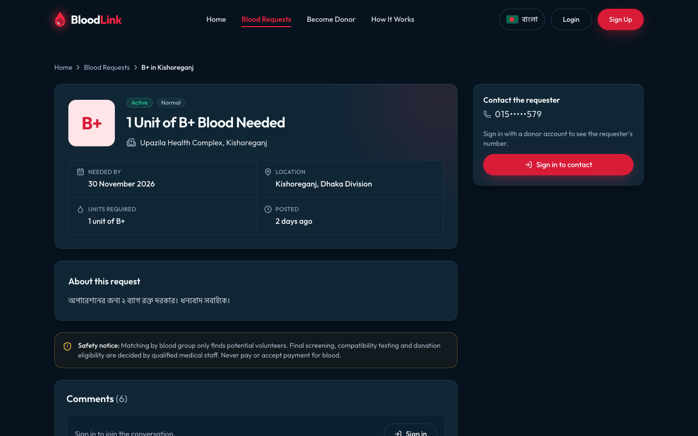
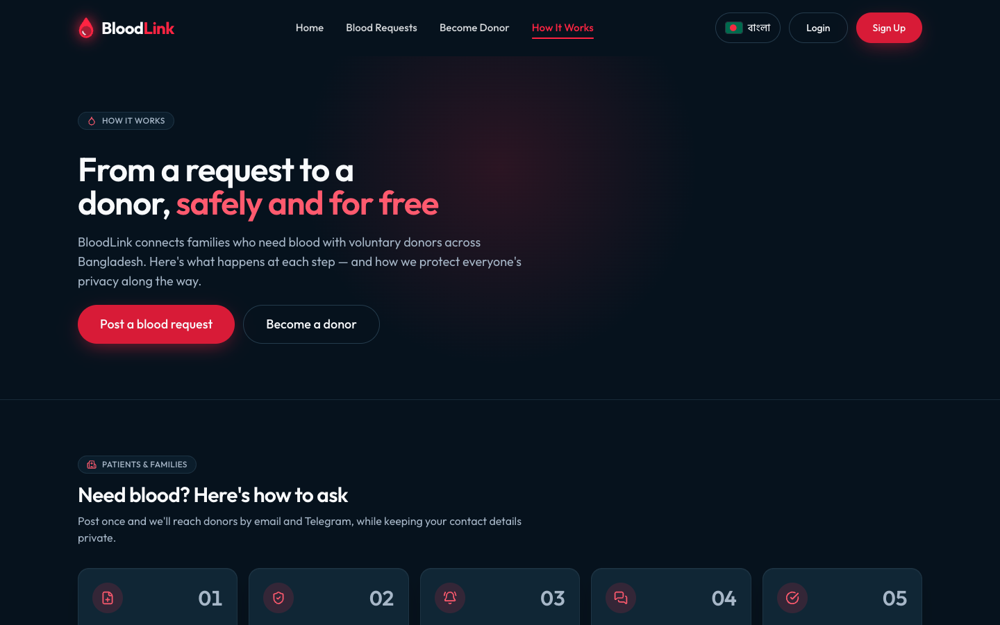
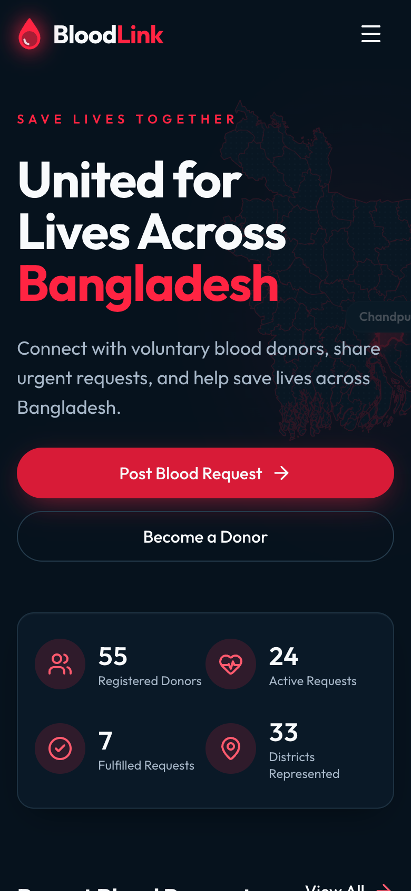

<div align="center">

# BloodLink

**United for Lives Across Bangladesh**

A free, community-run platform that connects people who need blood with voluntary donors across Bangladesh.

[](https://nextjs.org)
[](https://react.dev)
[](https://www.typescriptlang.org)
[](https://www.mongodb.com)



</div>

---

## About

BloodLink helps patients and families find blood quickly. Anyone can post a blood request. Every request is
reviewed by a moderator before it goes public, and matching donors are alerted by email and through a private
Telegram channel.

BloodLink is a volunteer platform. It never charges for anything, and blood must never be bought or sold.

## Screenshots

> The screenshots use demo data from a local development database.

<table>
  <tr>
    <td width="50%"></td>
    <td width="50%"></td>
  </tr>
  <tr>
    <td><b>Browse requests</b><br/>Filter by blood group, district, urgency and status.</td>
    <td><b>Request details</b><br/>Contact numbers stay masked until a signed-in donor reveals them.</td>
  </tr>
  <tr>
    <td width="50%"></td>
    <td width="50%"></td>
  </tr>
  <tr>
    <td><b>How it works</b><br/>Simple, step-by-step guidance for patients and donors.</td>
    <td><b>Mobile friendly</b><br/>Designed to work well on phones, in Bangla and English.</td>
  </tr>
</table>

## Features

- **Post a blood request.** Share the blood group, units, hospital, district, needed date and urgency. Attach a
  prescription if you have one.
- **Find requests quickly.** Filter by blood group, district, urgency and status, or search by hospital.
- **Register as a donor.** Sign in with Google, set your blood group and district, and choose how you want to
  hear about requests.
- **Instant alerts.** Matching donors who opt in receive an email, and approved requests are shared in a private
  Telegram donor channel.
- **Privacy first.** Phone numbers are encrypted and masked. Medical documents are visible only to the people the
  requester chooses.
- **Community discussion.** Comment on requests, reply to others, and report anything that looks wrong.
- **Moderation.** Admins review new requests, reports and comments before they go public.
- **Bangla and English.** Switch languages at any time.

## How it works

**For patients and families**

1. Sign in with Google and post a request.
2. A moderator reviews it and publishes it.
3. Matching donors are notified and can reply in the comments.
4. Mark the request as fulfilled once the blood has been found.

**For donors**

1. Sign in with Google and complete your donor profile.
2. Choose how you want to be alerted.
3. Get notified about requests that match your blood group and area.
4. Optionally link Telegram to join the private donor channel.

> **Important:** Matching by blood group only finds potential volunteers. Screening, compatibility testing and
> donation eligibility are always decided by qualified medical staff. Never pay or accept payment for blood.

## Built with

Next.js 16 (App Router) · React 19 · TypeScript · Tailwind CSS v4 · MongoDB · Auth.js (Google sign-in) ·
Brevo (email) · Telegram Bot API · Docker and nginx for deployment

## Getting started

**Requirements:** Node.js 24, npm, and a MongoDB database (a free MongoDB Atlas cluster or a local container).

```bash
git clone <repository-url>
cd blood-donor
npm install
cp .env.example .env.local   # then fill in your MongoDB and Google sign-in values
npm run dev                  # open http://localhost:3000
```

Optional: load demo data into a local MongoDB database.

```bash
npm run seed:dev
```

The environment variable reference, step-by-step setup for each integration, and the deployment guide are in the
[Developer guide](docs/DEVELOPER_GUIDE.md).

## Documentation

- [Developer guide](docs/DEVELOPER_GUIDE.md): architecture, configuration, integrations, deployment and testing.

---

<p align="center">
  <sub>BloodLink is a volunteer community platform and is not a medical service. Donation eligibility and
  compatibility are decided by qualified medical staff.</sub>
</p>
